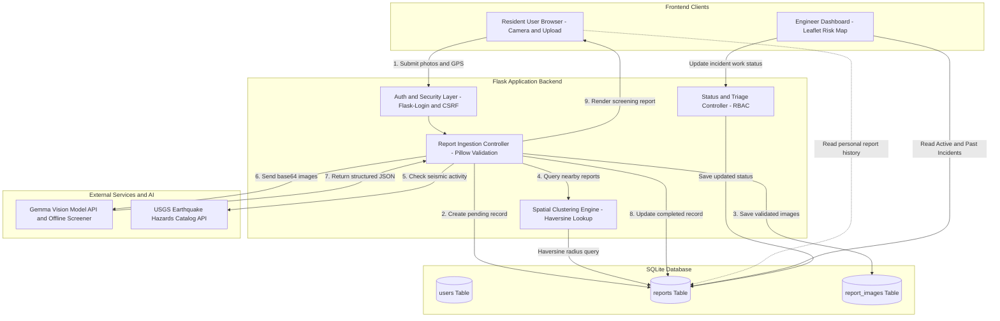

# Crowdsourced Seismic Vulnerability Reporting (MVP)

A simple, mobile-friendly web application for reporting and screening potential structural vulnerabilities in buildings and hillside retaining walls (e.g., cracks, masonry displacement, shear distress) in urban hill settlements.

Powered by **Python + Flask**, **SQLite**, **Bootstrap 5**, and the **Gemma Vision Model** (via configurable inference API or local offline screening).

---

## 🌟 Key MVP Features

1. **Mobile-First Report Submission**:
   - Camera capture directly from phone browser (`capture="environment"`) or gallery file upload.
   - Live client-side image preview with dimensions, file size, and quick replace/remove actions.
   - Optional user observation notes — users can submit images with or without a description.
   - Internal server-side system instruction and analysis prompt (users never need to write prompts).

2. **Gemma Vision Model Analysis**:
   - Rigorous structural screening prompt identifying visible cracks, unusual deformation, exposed reinforcement, water damage, and separation.
   - Explicit disclaimer and safety limitations: **never certifies structures as safe or structurally sound**.
   - Identifies surface observations, potential warning signs, photographic uncertainties, and recommended professional next steps.

3. **Follow-Up Additional Photographs Workflow**:
   - If initial framing is incomplete, Gemma requests specific complementary angles (e.g. wider perspective, scale reference with a coin/ruler).
   - User can upload additional photographs in response to recommendations.
   - Original and new photos are evaluated jointly, preserving the full report history.
   - Built-in limit on follow-up rounds (max 3 rounds) and a "Finish Report Now" action to prevent infinite loops.

4. **Transparent Results Page**:
   - Submitted photo gallery (lightbox modal preview).
   - "Potential warning signs observed" and "Further inspection recommended" badges (no unsupported numerical safety scores).
   - Prominent limitation advisories: photographic 2D limitations, subsurface ground motion uncertainties.

5. **Robust SQLite Persistence & File Security**:
   - Safe, cryptographically unique filenames (UUIDs).
   - Pillow-backed image verification and strict MIME/size checks (up to 16MB).
   - Preserves submissions if model inference fails, allowing user retries or offline screening.

---

## 📁 Project Structure

```text
├── app.py                  # Flask routes & request handling
├── config.py               # Application configuration & environment settings
├── database.py             # SQLite schema and data operations
├── services/
│   └── gemma.py            # Gemma vision model API integration & offline screener
├── templates/
│   ├── base.html           # Base layout, navbar, safety notices
│   ├── submit.html         # Mobile-first submission form with camera preview
│   ├── report.html         # Screening results, observation cards, follow-up flow
│   ├── reports_list.html   # Community crowdsourced reports feed
│   └── 404.html            # Error page
├── static/
│   ├── css/
│   │   └── style.css       # Design tokens, typography, mobile layout
│   └── js/
│       └── main.js         # File preview, validation, replace/remove, submit spinner
├── uploads/                # Safe local storage for uploaded photos
├── requirements.txt        # Python dependencies
├── .env.example            # Environment variables template
└── test_app.py             # Automated unit and integration test suite
```

---

## 🏗️ System Architecture & Workflow

The system is designed as a lightweight, secure civic infrastructure pipeline connecting citizen mobile camera uploads with AI-assisted structural screening and an engineer triage dashboard.



### 1. System Inputs

When a user submits a structural observation, the backend processes three primary inputs:

| Input | Source / Mechanism | Format & Validation | Required? |
| :--- | :--- | :--- | :--- |
| **Photographic Imagery** | Mobile camera stream snapshot or device gallery upload (`filePicker`) | JPEG, PNG, WEBP. Validated via Pillow (`Image.open(dest).verify()`), enforced 16MB file limit, stored under cryptographic UUID filenames. | **Yes** (at least 1 image) |
| **Geographic Coordinates (GPS)** | Browser HTML5 Geolocation API (`navigator.geolocation.getCurrentPosition`) | Float `latitude`, `longitude`, and `accuracy` (in meters). Sanitized server-side. If denied or unavailable, saved as `NULL` without breaking map or list views. | **Optional** (gracefully handled) |
| **Authenticated Identity** | Established session via Flask-Login (`current_user.id`) | Server-side session cookie only. Client-supplied IDs are ignored to prevent impersonation. | **Yes** (requires login) |
| **CSRF Token** | Embedded hidden input or `X-CSRFToken` request header | Signed token validated by Flask-WTF `CSRFProtect` on all POST actions. | **Yes** (on all mutations) |

> [!NOTE]
> **No User Prompts or Free-Text Required:** Users do not enter damage descriptions or prompts. The system uses a fixed, server-side system instruction and prompt to ensure consistent engineering evaluations.

---

### 2. How the AI Safety Score & Assessment are Generated

The screening process translates visible 2D photograph features into structured assessment indicators:

```
[Uploaded Photos] 
       │
       ▼
[Gemma Vision Model (API or Offline Fallback)]
       │
       ├──> summary: "Short description of visible structural damage"
       ├──> safety_score: 1 to 10 (integer)
       ├──> recommended_action: Predefined category
       └──> evidence: "Visible crack pattern, spalling, or displacement"
       │
       ▼
[Spatial & Seismic Corroboration Engine]
       ├──> Nearby Cluster Density (Haversine formula within 500m/1000m)
       └──> USGS Regional Earthquake Catalog (M4.0+ within 300 km / 30 days)
       │
       ▼
[Area Inspection Priority] (HIGH / MEDIUM / LOW)
```

#### A. Safety Score (1–10 Scale)
The Gemma Vision model is provided with a strict system instruction and JSON schema. The integer score represents **visible surface indicators of structural concern**:

* **Scores 1–3 (`URGENT_ASSESSMENT`):** Severe concern indicating potential instability or collapse risk (e.g., wide diagonal shear fractures crossing masonry units, out-of-plane bulging or tilting of retaining walls, crushed load-bearing members).
* **Scores 4–6 (`PROFESSIONAL_INSPECTION`):** Moderate concern requiring engineering verification (e.g., significant stepped cracks >3mm, retaining wall surcharge cracking, extensive mortar decay, efflorescence with spalling, or high diagnostic uncertainty).
* **Scores 7–8 (`REPAIR_RECOMMENDED`):** Minor or superficial distress (e.g., hairline plaster shrinkage fissures <1–2mm, non-structural cosmetic weathering, surface render cracking).
* **Scores 9–10 (`NO_OBVIOUS_WARNING_SIGNS`):** Clean, intact surfaces with no visible cracks or deformation in the submitted photograph(s).

> [!IMPORTANT]
> **Preliminary Screening Disclaimer:** A high safety score (e.g., 9 or 10) indicates only that concerning signs are absent in the visible 2D photograph; it **never certifies a structure as safe or seismically sound**.

#### B. Sanitization & Fallback
1. **Response Sanitization:** Model output is parsed via `parse_model_json_response()`. The score is clamped between 1 and 10 via `sanitize_safety_score()`, and the action is normalized to one of the 4 valid enum values via `sanitize_recommended_action()`.
2. **Offline Screening Fallback:** If `GEMMA_API_KEY` is not set or the API is unreachable, `run_offline_structural_screening()` uses image heuristics (edge complexity, high-contrast fissures, brightness distribution) to generate a conservative preliminary assessment.

#### C. Area Inspection Priority
In urban hillside settlements, structural damage often clusters. The backend executes `analyze_nearby_reports()` to compute a regional triage priority:
* **`HIGH` Priority:** If the report's score is ≤3, its recommended action is `URGENT_ASSESSMENT`, or ≥2 nearby reports in the area exhibit severe damage.
* **`MEDIUM` Priority:** If ≥2 reports exist within the cluster radius, the action is `PROFESSIONAL_INSPECTION`, or a corroborated M4.0+ regional earthquake was recorded in the USGS catalog within 300 km and the last 30 days.
* **`LOW` Priority:** Isolated report with no concerning local clusters.

#### D. Risk Marker Coloring on the Engineer Map
Markers on the Leaflet map are colored **strictly by risk score**, independently of work status:
* 🔴 **Red:** Score 1–3 (high concern)
* 🟠 **Orange:** Score 4–6 (moderate concern)
* 🟢 **Green:** Score 7–10 (fewer warning signs)
* ⚪ **Neutral Gray:** Missing or invalid score

---

### 3. Database Interaction Lifecycle (When SQLite is Checked)

The SQLite database (`seismic_reports.db`) operates with strict parameterized queries and foreign keys (`PRAGMA foreign_keys = ON`). Database touchpoints occur across five distinct lifecycles:

#### 1. Application Startup (`init_db`)
* **When:** Executed once when Flask starts.
* **Actions:**
  - Creates tables `users`, `reports`, and `report_images` if they do not exist.
  - Inspects existing table schema via `PRAGMA table_info(reports)`.
  - Safely adds missing columns (e.g., `user_id`, `work_status`, `latitude`, `safety_score`) via `ALTER TABLE` without dropping existing tables.
  - Ensures indexes exist (`idx_users_email`, `idx_reports_user_id`, `idx_reports_created`, `idx_reports_gps`, `idx_reports_priority`, `idx_reports_work_status`).
  - **Never deletes existing reports or clears history.**

#### 2. Authentication & Session Management
* **Registration (`POST /register`):**
  - Checks if email exists: `SELECT * FROM users WHERE email = ?`.
  - Inserts user record: `INSERT INTO users (id, email, password_hash, role, created_at) VALUES (...)`.
* **Login (`POST /login`):**
  - Queries user by email: `SELECT * FROM users WHERE email = ?`.
  - Compares password against stored Werkzeug hash.
* **Session Reload (`@login_manager.user_loader`):**
  - On every authenticated request, loads user identity: `SELECT * FROM users WHERE id = ?`.

#### 3. Report Submission Pipeline (`POST /submit`)
During submission, the database is accessed in three steps:
1. **Immediate Staging:** Inserts the initial record with `status = 'pending'`, `work_status = 'not_done'`, and `user_id = current_user.id`. Image metadata is inserted into `report_images`.
2. **Cluster Comparison:** Queries recent records within the geographic radius and 14-day window:
   `SELECT id, latitude, longitude, summary, safety_score, recommended_action, created_at FROM reports WHERE id != ? AND latitude IS NOT NULL AND created_at >= ?`
3. **Post-Inference Finalization:** Updates the report with AI results:
   `UPDATE reports SET status = 'completed', summary = ?, safety_score = ?, recommended_action = ?, evidence = ?, area_priority = ?, nearby_report_count = ?, earthquake_info = ? WHERE id = ?`

#### 4. Viewing Reports & Report Caching
* **Single Report (`GET /report/<report_id>`):**
  - **Reads strictly from SQLite:** `SELECT r.*, u.email as submitter_email FROM reports r LEFT JOIN users u ON r.user_id = u.id WHERE r.id = ?`.
  - Fetches associated images from `report_images`.
  - Fetches nearby reports for thumbnail clustering.
  - **CRITICAL:** Viewing an existing report **NEVER calls Gemma Vision or external APIs again**. Results are permanently cached in SQLite.
* **User History (`GET /reports`):**
  - Queries only reports owned by the logged-in user:
    `SELECT r.* FROM reports r WHERE r.user_id = ? ORDER BY r.created_at DESC`.

#### 5. Engineer Dashboard & Incident Management
* **Loading Incidents (`GET /engineer?view=active|past`):**
  - Partitioned query:
    - **Active Incidents:** `WHERE r.work_status IN ('not_done', 'in_progress') OR r.work_status IS NULL`
    - **Past Incidents:** `WHERE r.work_status = 'done'`
  - Calculates real-time view counts via `get_incident_counts()` using conditional aggregation (`SUM(CASE WHEN ...)`).
* **Updating Work Status (`POST /report/<report_id>/status`):**
  - Immediately persists status change:
    `UPDATE reports SET work_status = ?, updated_at = ? WHERE id = ?`
  - Does **not** modify AI-generated safety scores, area priority, or summaries.

---

## 🔐 User Authentication & Roles

The application provides email-and-password authentication built with **Flask-Login**, **Werkzeug**, and **Flask-WTF**:

### Roles & Permissions

1. **User (`user`)**:
   - Register and sign in with email and password.
   - Capture or upload structural photographs.
   - Submit damage images for Gemma vision screening with GPS location.
   - View their own generated report with AI summary, safety score, and recommended action.
   - Access **My Reports** (`/reports`) to review past personal submissions.
   - Cannot access the Engineer Dashboard or view reports submitted by other users.
   - Cannot modify incident work status.

2. **Engineer (`engineer`)**:
   - Register and sign in with email and password.
   - Access the **Engineer Dashboard** (`/engineer`).
   - Switch between **Active Incidents** and **Past Incidents**.
   - View all submitted reports, images, GPS coordinates, and AI safety indicators.
   - Update incident work status between **Not Done**, **In Progress**, and **Done**.
   - View risk-colored markers on the interactive Leaflet map.
   - Cannot manually modify AI-generated safety scores or summaries.

---

## 🚀 Getting Started

### 1. Prerequisites
- Python 3.10+ (tested on Python 3.14)
- Virtual environment (`venv`)

### 2. Installation
```bash
python3 -m venv .venv
source .venv/bin/activate
pip install -r requirements.txt
```

### 3. Configuration
Copy `.env.example` to `.env`:
```bash
cp .env.example .env
```

Configure environment settings in `.env`:
```ini
# Flask Security & Session
FLASK_SECRET_KEY=your-secure-random-secret-key-here
FLASK_DEBUG=True
SESSION_COOKIE_SECURE=False
WTF_CSRF_ENABLED=True

# Gemma Vision Model Configuration
GEMMA_API_KEY=your_google_ai_studio_api_key
GEMMA_MODEL_NAME=gemma-4-26b-a4b-it
GEMMA_API_URL=https://generativelanguage.googleapis.com/v1beta/models/{model}:generateContent
GEMMA_PROVIDER=auto

# Fallback Mode for Offline / Demonstration:
GEMMA_MOCK_FALLBACK=true
```

### 4. Database Initialization & Migration
The application automatically creates tables and safely applies migrations during startup:
```bash
python -c "import database; database.init_db()"
```
This preserves existing reports while adding the `users` table and linking `reports.user_id`.

### 5. Running the Application
```bash
python app.py
```
Open your browser to `http://127.0.0.1:5000`.
- Unauthenticated visitors are directed to `/login` or `/register`.
- Registering as a **User** routes to the photo reporting page (`/`).
- Registering as an **Engineer** routes to the Engineer Dashboard (`/engineer`).

### 6. Running the Test Suite
```bash
python -m unittest test_app.py
```

---

## 🔒 Security & Safety Disclaimers

- **Never a Substitute for Professional Assessment**: A photograph alone cannot establish structural integrity or seismic safety. All screens emphasize on-site evaluation by licensed civil/structural engineers.
- **Password Security**: Passwords require at least 8 characters and are securely hashed with Werkzeug before storage in SQLite. Plaintext passwords are never stored.
- **CSRF Protection**: All state-changing forms and AJAX actions require Flask-WTF CSRF tokens.
- **Server-Side Authorization**: Report access and engineer endpoints strictly enforce ownership and role checks on the backend (HTTP 403 Forbidden).
- **Upload Hardening**: Files are validated with Pillow byte inspection, sanitized against path traversals, and stored under randomized UUIDs.
